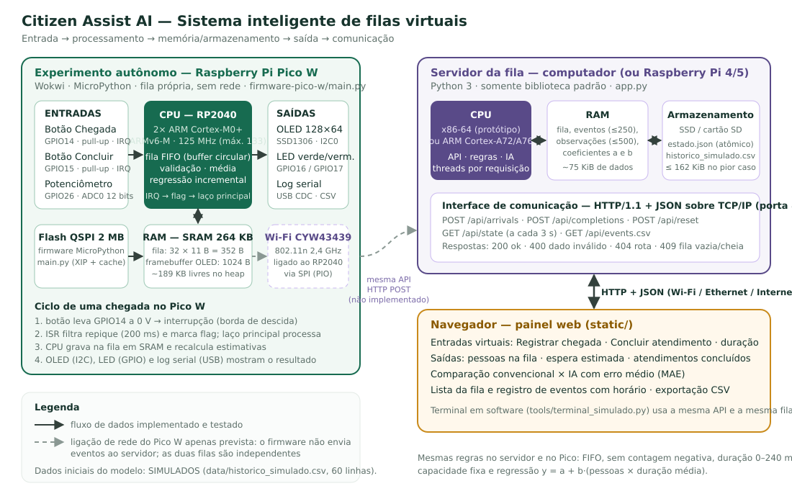

# Citizen Assist AI — Sistema Inteligente de Gerenciamento de Filas Virtuais

Global Solution 2026.2 · Arquitetura e Organização de Computadores · Turma 1CC-FEV

**Integrantes:** Ryan Luther Roque (RM 572993) e João Guilherme Figueiredo (RM 572697)

O trabalho tem um protótipo principal e um experimento separado:

- **Protótipo principal — servidor + painel web + terminal em rede** (Python): o servidor é a fonte oficial da fila. Recebe as operações por HTTP/JSON, registra eventos com horário, compara a estimativa convencional com a regressão linear e mostra tudo no navegador. O terminal de atendimento em software ([`tools/terminal_simulado.py`](tools/terminal_simulado.py)) envia chegadas e conclusões para a mesma API: o que é feito no terminal aparece no painel, e vice-versa.
- **Experimento autônomo — terminal em um Raspberry Pi Pico W** (simulado no [Wokwi](https://wokwi.com)): botões físicos, potenciômetro, display OLED e LEDs, com a fila e a regressão rodando no microcontrolador RP2040. Ele tem fila própria e **não se comunica com o servidor**; a ligação por Wi-Fi é apenas prevista.



## Como executar

### 1. Servidor e painel web

Requisito: Python 3.10 ou superior. Não usa bibliotecas externas.

```bash
cd fila-virtual-citizen-assist
python app.py
```

Abra <http://127.0.0.1:8000>. No Windows também funciona `py app.py`. Para encerrar, pressione `Ctrl+C`.

Para acessar de outro computador ou celular da mesma rede (PowerShell):

```powershell
$env:FILA_HOST = "0.0.0.0"; python app.py
```

Em seguida abra `http://IP-DO-COMPUTADOR:8000` no outro aparelho; o firewall pode pedir permissão.

O estado fica em `data/estado.json`, criado automaticamente e ignorado pelo Git. O botão **Reiniciar** do painel zera a demonstração.

#### Terminal de atendimento em rede

Com o servidor ligado, em outra janela:

```bash
python tools/terminal_simulado.py            # ou: python tools/terminal_simulado.py http://ENDERECO-DO-SERVIDOR
```

Teclas: `c` registra uma chegada, `s 7` conclui um atendimento de 7 minutos, `e` mostra o estado, `q` sai. Deixe o painel aberto ao lado: cada ação aparece nele em até 3 segundos, com "origem: terminal". Se o envio falhar, o terminal tenta de novo com o mesmo identificador de evento e o servidor não conta duas vezes.

#### Acesso pela internet (preparado; a equipe ainda precisa executar e registrar)

1. Defina um código de operador, para que só quem o conhece altere a fila (a consulta continua pública). PowerShell:

   ```powershell
   $env:FILA_TOKEN = "escolha-um-codigo"; python app.py
   ```

   O painel pede o código na primeira alteração. No terminal em rede, defina a mesma variável antes de executá-lo.
2. Publique o endereço local por um túnel HTTPS. Exemplo com o [Cloudflare Tunnel](https://developers.cloudflare.com/cloudflare-one/connections/connect-networks/do-more-with-tunnels/trycloudflare/) (gratuito, sem conta): instale o `cloudflared` e execute `cloudflared tunnel --url http://localhost:8000`. Ele mostra uma URL `https://….trycloudflare.com`, válida enquanto o comando estiver aberto.
3. Abra a URL em um aparelho fora da sua rede (celular em dados móveis) e confirme que o painel carrega e se atualiza.
4. Registre a URL, a data e o resultado em `docs/relatorio-tecnico.md` (seção 7.5).

Alternativa: hospedar `app.py` em um serviço que execute Python. O servidor lê a porta da variável `PORT` e deve iniciar com `FILA_HOST=0.0.0.0`. Em hospedagens com disco temporário, a fila é perdida quando o serviço reinicia.

Em 18/11/2026 o acesso externo foi testado: o servidor foi publicado por um túnel Cloudflare e aberto em um celular com dados móveis (fora da rede local). A URL era temporária. Detalhes e limites do teste em `docs/relatorio-tecnico.md`, seção 7.5.

### 2. Terminal Raspberry Pi Pico W (Wokwi)

Projeto já salvo: <https://wokwi.com/projects/480879311582717953> (abra e clique em ▶). Para montar do zero:

1. Abra <https://wokwi.com/projects/new/micropython-pi-pico-w>.
2. Cole [`firmware-pico-w/main.py`](firmware-pico-w/main.py) na aba **main.py** e [`firmware-pico-w/diagram.json`](firmware-pico-w/diagram.json) na aba **diagram.json**.
3. Clique em ▶. Use os botões **Chegada** e **Concluir** e gire o potenciômetro para mudar a duração.

Detalhes, pinagem e o log de uma execução real: [firmware-pico-w/README.md](firmware-pico-w/README.md).

### 3. Testes automatizados

```bash
cd fila-virtual-citizen-assist
python -m unittest discover -s tests -v
```

São 22 testes: os quatro cenários mínimos do enunciado, validações, modelo e a comunicação terminal → servidor → painel (reenvio sem duplicar, reenvio de operação recusada, cabeçalho inválido e código do operador). Todos passaram em 16/11/2026; a saída está em [docs/evidencias/](docs/evidencias/).

## Requisitos do enunciado × onde estão atendidos

| Requisito | Onde |
| --- | --- |
| **Etapa 1** — diagrama com CPU, RAM e armazenamento, entradas, saídas e interface de internet; fluxo de informações | [docs/diagrama-arquitetura.svg](docs/diagrama-arquitetura.svg), [docs/arquitetura.md](docs/arquitetura.md) |
| **Etapa 2** — chegada por botão, conclusão por outro botão, atualização automática, bloqueio de contagem negativa e operações inválidas, total na fila, eventos com horário | `firmware-pico-w/main.py` (botões GP14/GP15, OLED, log serial); `app.py` (API, validações, `events.csv`); `static/` (painel) |
| **Etapa 3** — estimativa por média histórica × regressão linear, com dados simulados identificados | `app.py` (`regression`, `evaluate`), `data/historico_simulado.csv` (coluna `origem = simulado`), `tools/gerar_historico.py`; relatório, seção 4 |
| **Etapa 4** — interface web com fila, espera estimada, concluídos e atualização pela comunicação com o sistema | `static/index.html` + `static/app.js` (consulta `GET /api/state` a cada 3 s) |
| **Etapa 5** — processador, memória e uso, entrada/processamento/saída, protocolos, limitações | [docs/relatorio-tecnico.md](docs/relatorio-tecnico.md), seção 6 |
| **Entregável 01** — protótipo funcional | servidor + painel + terminal em rede (principal); terminal Pico W no Wokwi (experimento autônomo) |
| **Entregável 02** — diagrama de arquitetura | `docs/diagrama-arquitetura.svg` |
| **Entregável 03** — código-fonte documentado com instruções | este README e os comentários do código |
| **Entregável 04** — relatório técnico | [docs/relatorio-tecnico.md](docs/relatorio-tecnico.md) |
| **Entregável 05** — vídeo de até 5 min | roteiro em [docs/roteiro-demonstracao.md](docs/roteiro-demonstracao.md) — **vídeo ainda não gravado**; a gravação é feita pela equipe |
| **Testes mínimos** (1) chegada (2) conclusão (3) saída com fila vazia (4) atualização da estimativa | `tests/test_fila.py`, [docs/plano-de-testes.md](docs/plano-de-testes.md) |

## Estrutura

```
fila-virtual-citizen-assist/
├── app.py                     servidor HTTP, regras da fila, persistência, modelo
├── static/                    painel web (HTML, CSS, JavaScript)
├── firmware-pico-w/           terminal Raspberry Pi Pico W (MicroPython + circuito Wokwi)
├── data/historico_simulado.csv  60 registros SIMULADOS para treinar o modelo
├── tools/gerar_historico.py   gera o CSV simulado (semente fixa, reproduzível)
├── tests/test_fila.py         testes automatizados (unittest)
└── docs/                      arquitetura, diagrama, relatório, plano de testes, roteiro
```

## API

| Método e rota | Função |
| --- | --- |
| `GET /api/state` | estado da fila, estimativas, modelo e últimos eventos |
| `POST /api/arrivals` | registra chegada |
| `POST /api/completions` com `{"duration_minutes": 7}` | conclui o atendimento da primeira pessoa |
| `POST /api/reset` | reinicia a demonstração |
| `GET /api/events.csv` | exporta o registro de eventos |

Erros: `400` dado inválido · `401` código do operador ausente ou incorreto (só quando `FILA_TOKEN` está definido) · `404` rota inexistente · `409` fila vazia ou cheia.

Os `POST` aceitam `source` (origem do evento) e `event_id` (identificador único): um `event_id` repetido não é aplicado de novo e a resposta traz `"duplicate": true`.

## Limitações

- Os dados iniciais do modelo são **simulados**. O ganho da regressão (MAE 2,86 contra 3,35 min) vale para esse cenário e precisaria ser validado com dados reais.
- O Pico W não envia eventos ao servidor: sua fila é independente da fila do painel. A comunicação em rede é demonstrada pelo terminal em software e pelo painel.
- O acesso pela internet está preparado (código do operador e instruções de túnel), mas ainda não foi executado nem verificado fora da rede local.
- O código do operador é uma proteção simples para demonstração; o HTTPS depende do túnel ou da hospedagem.
- Simulação do Pico W salva no Wokwi: <https://wokwi.com/projects/480879311582717953> (16/11/2026). Ainda não há vídeo de demonstração: é pendência da equipe.
